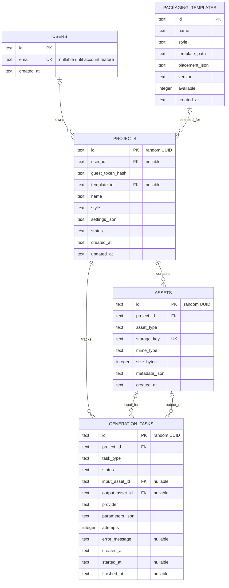

# ER Diagram

Schema version 1. SQLite implementation: `backend/app/db/database.py`.

`USERS` exists only as a future owner table; no registration, login, password, or account API is implemented. Guest projects use a random project UUID plus a 256-bit capability token. Only the SHA-256 token hash is stored in SQLite. The plaintext token is returned once at creation and retained by the frontend for that browser origin. Migration v2 adds `projects.template_id`; new projects select the available template for their style.

`settings_json`, `metadata_json`, and `parameters_json` keep MVP settings flexible while their owning project/asset/task remain relational. Files themselves are never stored as SQLite BLOBs.